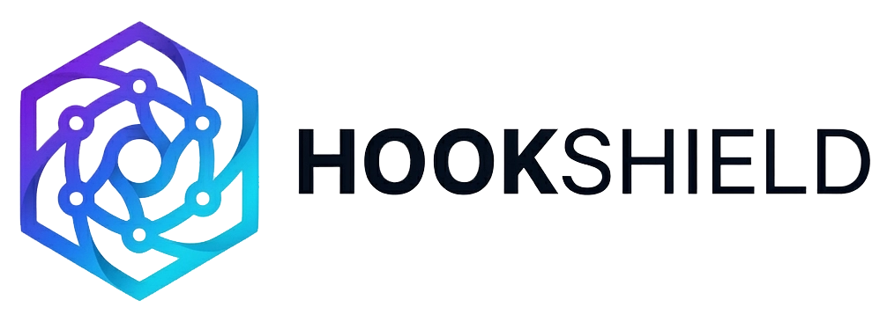
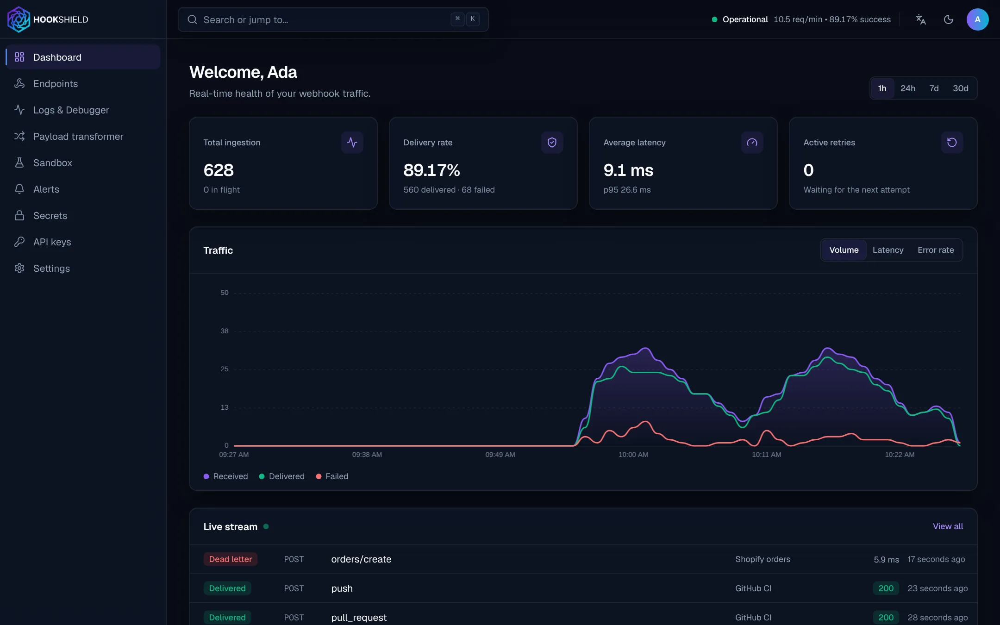

<p align="center">
  <picture>
    <source media="(prefers-color-scheme: dark)" srcset="docs/assets/brand-to-dark.webp">
    
  </picture>
</p>

<p align="center">
  <strong>Open-source, zero-trust webhook gateway.</strong><br>
  Authenticate, transform, encrypt (AES-256-GCM) and reliably deliver webhooks — with retries, alerts and a live debugger.
</p>

<p align="center">
  <a href="https://hookshield.dev"><strong>Website</strong></a> ·
  <a href="https://hookshield.dev/docs/"><strong>Documentation</strong></a> ·
  <a href="https://app.hookshield.dev">HookShield Cloud</a> ·
  <a href="docs/SELF_HOSTING.md">Self-hosting</a> ·
  <a href="docs/CLI.md">CLI</a> ·
  <a href="SECURITY.md">Security</a>
</p>

<p align="center">
  <a href="https://github.com/hookshield-hq/hookshield/actions/workflows/ci.yml"></a>
  <a href="https://github.com/hookshield-hq/hookshield/releases"></a>
  <a href="LICENSE"></a>
</p>

<p align="center">
  
</p>

> **Status: v0.1, public beta.** Tested (unit, integration, end-to-end, load) and security-reviewed — findings and known limitations are in [SECURITY.md](SECURITY.md) — but young — start with non-critical endpoints and [tell us](https://github.com/hookshield-hq/hookshield/issues) what breaks.

---

## Why HookShield?

Most webhook receivers store payloads in plain text, process requests synchronously and retry poorly. HookShield puts an **edge ingestion pipeline** in front of your app:

1. **Instant token guard** — unauthorized calls are dropped *before* anything is stored.
2. **Payload & header transformation** — strip, add, rename and format fields.
3. **Encrypted persistence** — every payload is encrypted at rest with AES-256-GCM.
4. **Reliable outbound dispatch** — exponential backoff, configurable retries, dead-letter queue.
5. **Alerts** — get notified (webhook, email, Slack, Telegram) when deliveries keep failing.

```
Sender ──► [Token check] ──► Processing queue ──► Transform + encrypt + store ──► Dispatch queue ──► Your app
               │ invalid                                                              │ fails N times
               ▼                                                                      ▼
          401 dropped                                                         Retry ► DLQ ► Alert
```

## Features

| | |
|---|---|
| 🔐 Zero-trust ingestion | Header token, HMAC signature or IP allow-list per endpoint |
| 🧬 Transform pipeline | Visual editor with live input → output preview |
| 🔁 Retry policies | Fixed, exponential or custom; dead-letter queue |
| 🔎 Debugger | Per-stage latency timeline, original vs transformed payloads, one-click replay |
| ⌨️ Keyboard-first UI | `⌘K` everywhere, dark mode by default |
| 🌍 Multilingual | English, Português and Español |
| 🚀 Self-host in 1 click | Docker Compose, Coolify, Render, Railway |
| 💻 CLI | `hookshield listen` forwards webhooks to your localhost; `hookshield trigger` sends test events |

## Tech stack

| Layer | Technology |
|---|---|
| Ingest, worker, API, CLI | Go (standard library first) |
| Queues & cache | Redis Streams |
| Database | PostgreSQL |
| Dashboard | Next.js (App Router), TypeScript, Tailwind CSS, Framer Motion, next-intl |
| Billing (cloud) | Paddle (merchant of record) |
| Deploy | Docker, Caddy, Coolify |

## Repository layout

```
backend/     Go module — cmd/{ingest,worker,api,hookshield-server,hookshield} + internal packages
web/         Next.js dashboard (endpoints, logs & debugger, transformer, sandbox, alerts, keys)
deploy/      Production Docker Compose + Caddyfile, backup scripts, Coolify and Railway templates
Dockerfile   All-in-one image (one-click deploys); render.yaml is the Render Blueprint
docs/        Documentation (rendered at hookshield.dev/docs), UI spec, brand assets
website/     Public website: landing page (en, pt-BR, es) + docs, static export
```

## Quickstart

Requirements: **Docker** (with Compose v2) and **Make**.

```bash
git clone https://github.com/hookshield-hq/hookshield && cd hookshield
make up      # builds and starts the dashboard, api, ingest, worker, postgres, redis + a demo destination
             # → dashboard at http://localhost:3000 (create an account)
make demo    # seeds a demo endpoint, sends a webhook and checks it was delivered
make logs    # watch the demo destination print every delivery
make demo-alert   # make a delivery fail and get the alert email (Mailpit: http://localhost:8025)
```

```
• seeding demo data…
• sending webhook to http://localhost:8080/v1/ep_demo…
  accepted, id 01a1a259-c5fa-74c0-b291-e7fda4ce4e13
• waiting for delivery at http://localhost:4000 (up to 30s)…
✓ delivered to the sink in ~1s on attempt 1 (id 01a1a259-…, event smoke.test)
```

Developing the backend? `make dev-up && make dev` runs everything natively with Go (rebuilds in seconds), and `make smoke` checks it end to end. Working on the dashboard? Add `make web-install && make web-dev` (Node 22+) for hot reload — see [web/README.md](web/README.md). See [docs/DEVELOPMENT.md](docs/DEVELOPMENT.md) for every command, how to watch retries happen, and conventions.

## CLI

```bash
curl -fsSL https://raw.githubusercontent.com/hookshield-hq/hookshield/main/scripts/install.sh | sh
hookshield login                                              # API URL + an API key from the dashboard
hookshield listen ep_k3j7x2m4q5ab --forward localhost:3000/webhooks
hookshield trigger ep_k3j7x2m4q5ab --event invoice.paid       # in another terminal
```

Your app receives each webhook exactly as HookShield would deliver it (body byte for byte, so signatures still verify). Linux, macOS and Windows builds are on the [releases](https://github.com/hookshield-hq/hookshield/releases); details in [docs/CLI.md](docs/CLI.md).

## Deploy

[](https://render.com/deploy?repo=https://github.com/hookshield-hq/hookshield)

| Where | How |
|---|---|
| **Your server** (Docker Compose, HTTPS by Caddy) | `cd deploy && ./setup.sh hooks.example.com && docker compose up -d` |
| **Render** | The button above (all-in-one image + Render Postgres + Key Value) |
| **Railway** | Template — recipe in [deploy/railway](deploy/railway/README.md) |
| **Coolify** | Paste [deploy/coolify/docker-compose.yml](deploy/coolify/docker-compose.yml) into a Docker Compose resource |

Prefer not to run it? [HookShield Cloud](https://hookshield.dev/#pricing) is the same product, hosted, with a free plan.

Everything is served from one URL: the dashboard at `/`, the API at `/v1`, webhook URLs at `/in/v1/{slug}`. The first start applies the migrations and generates the encryption key — **back it up**. Details, backups and upgrades: [docs/SELF_HOSTING.md](docs/SELF_HOSTING.md).

## Security

Found a vulnerability? Please report it privately — see [SECURITY.md](SECURITY.md), which also describes what HookShield protects, how to run it safely and the known limitations. Performance numbers and the load-test tool: [docs/PERFORMANCE.md](docs/PERFORMANCE.md).

## Contributing

Contributions are welcome — read [CONTRIBUTING.md](CONTRIBUTING.md) first. Every change ships with **tests** and **documentation**.

## License

[MIT](LICENSE) © 2026 hookshield-hq
